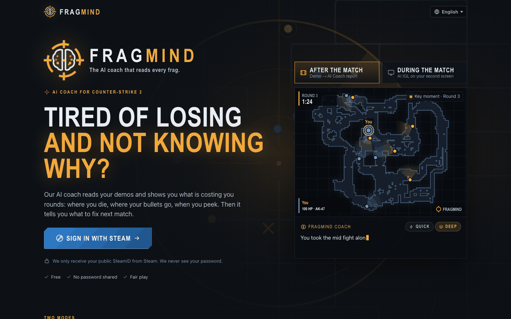
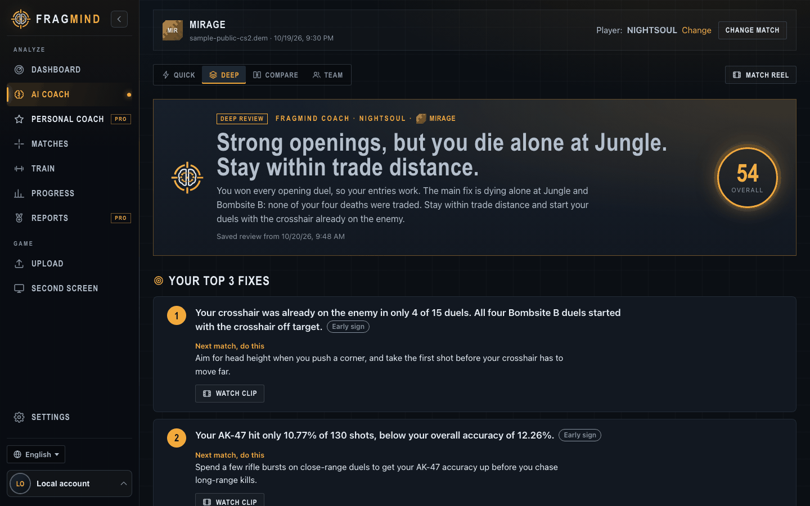
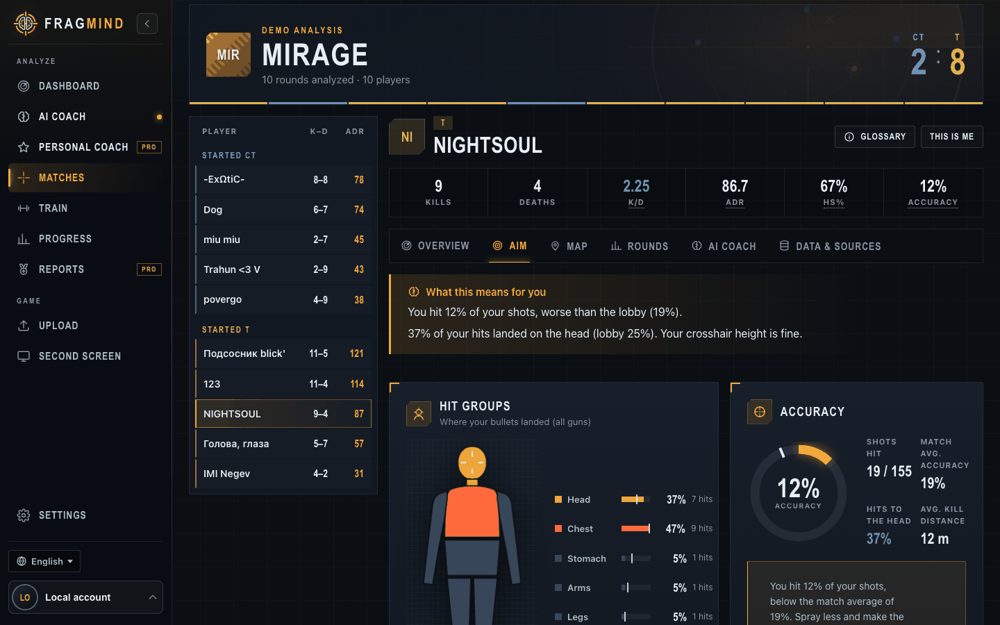
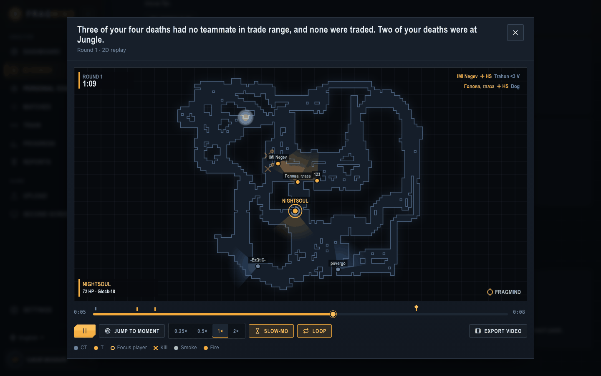
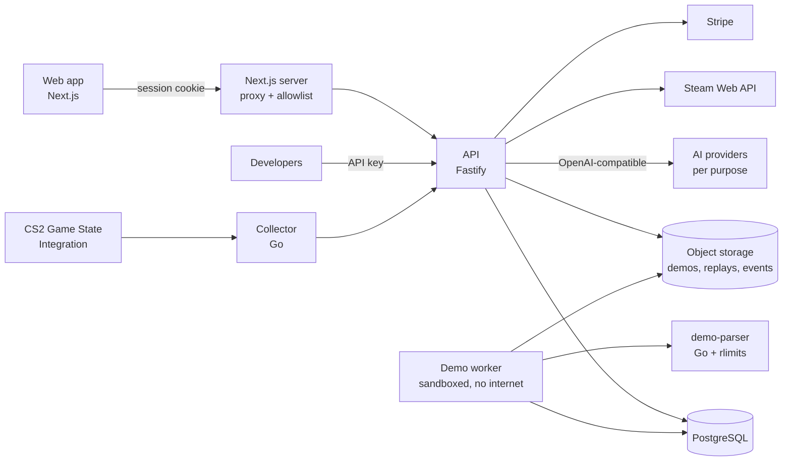

<div align="center">


# FRAGMIND

**The AI coach that reads every frag.**

Upload a Counter-Strike 2 demo and get what a pro coach would tell you: where your bullets land, where you keep dying, which habits cost you rounds, and a concrete practice plan built from your own match. During a game, a second screen gives you one IGL call between rounds.

[](https://github.com/marcus-girolneto/cs2-live-intelligence/actions/workflows/ci.yaml)


[Features](#what-it-does) · [Engineering highlights](#engineering-highlights) · [Architecture](#architecture) · [Run it](#run-it-locally) · [Public API](#public-api) · [Docs](#documentation)

</div>

<p align="center">
  
  
</p>
<p align="center">
  
  
</p>

> Independent project, not affiliated with or endorsed by Valve Corporation. Counter-Strike 2 is a trademark of Valve Corporation.

## Why this exists

Most players never watch their demos. Reviewing a match takes time and you need to know what to look for. Stat sites show numbers, but numbers don't tell you what to do next match.

FRAGMIND turns a demo into decisions:

- **What went wrong, with proof.** Every claim cites the exact demo events it came from, and a second model checks the numbers before you see them.
- **What to do about it.** Each review ends with a short plan and practice sessions built from your own match: console commands that teleport you to the exact spot where you died, your best grenade throws to rehearse, and the angle your crosshair should have held.
- **Whether it worked.** The next match shows if you applied each tip (traded deaths went from 6% to 31%, or they didn't).

## What it does

**Demo analysis** (deterministic, no AI)

- Accuracy, hit groups on a body diagram, weapons, headshot rate, ADR, KAST, opening duels, trades, clutches, multi-kills.
- Kill and death map by callout, round-by-round kill feed, buy types and economy, utility log (flashes, smokes, HE, molotovs).
- Crosshair placement at the start of each duel, isolation and crossfire at each death, danger zones.
- Every metric has a formula and links to the events that produced it.

**AI coach**

- **Quick review:** verdict, scores per area against the lobby, top 3 fixes, key moments with 2D replay clips, drills and a plan.
- **Deep review:** adds a utility lab, crosshair placement, positioning and a round table, using a stronger model.
- **Team review:** one IGL-style review of the whole five-stack: trade network, roles, utility coordination, man-advantage conversion, plan per player.
- **Personal coach:** reads all your matches and writes a multi-week program: what works, what doesn't, focus areas with targets.
- **Live IGL:** a second screen fed by CS2 Game State Integration. One call per round, only between rounds, only from your own state. Never during a fight, never hidden information.
- Coach personality (aggressive, passive, tone, role, custom instructions) and learning from your history, split into general habits and map-specific ones.

**Product**

- Steam sign-in, profile from the Steam Web API, "my matches" vs external demos, progress timeline with plan adherence.
- Credits, plans and credit packs with Stripe (off unless configured), anti-abuse rules for the free credit.
- Match integrity signals (statistically unusual aim, bans after the match) shown only to the uploader in neutral wording. Deaths to flagged players don't count against you.
- 9 languages, admin area for AI providers and models per purpose, integrations, users, plans and audit.

## Engineering highlights

Things worth a look if you are reviewing this as a codebase:

| Area                     | What was done                                                                                                                                                                                                                                                                                                                                 |
| ------------------------ | --------------------------------------------------------------------------------------------------------------------------------------------------------------------------------------------------------------------------------------------------------------------------------------------------------------------------------------------- |
| **Untrusted input**      | Demos (up to 500 MB) are parsed by a separate worker container with no internet access, a read-only filesystem, no Linux capabilities, a non-root user, memory, CPU and PID limits, and per-process rlimits on the parser binary.                                                                                                             |
| **Fuzzing**              | Go native fuzzing on the demo parser found 23-byte files that made the third-party library allocate 2 to 4 GiB. Frames are now validated before the library sees them, and the regression corpus runs on every `go test`.                                                                                                                     |
| **Prompt security**      | Every AI purpose goes through one pipeline: Unicode normalization and invisible-character stripping, per-request random data boundaries, canary tokens, n-gram leak detection, output validation of ids, links, model names and cheat advice. Live red team: 0 of 50 injection attempts succeeded. See [AI_SECURITY.md](docs/AI_SECURITY.md). |
| **Grounded AI**          | The model only sees numbered facts. The server drops claims that cite unknown evidence, checks every number and "consecutive rounds" claim deterministically, and a second, cheaper model verifies each sentence. Sample-size confidence ranks weak signals last.                                                                             |
| **Model choice by data** | A bake-off ran 27 OpenRouter models through the real pipeline and scored grounding, language purity, latency and real cost per call. Providers and models are configurable per purpose at runtime, keys encrypted at rest (AES-256-GCM). A nightly eval and prompt A/B tests keep it honest.                                                  |
| **Architecture**         | API in layers per module (routes, controller, service, repository, DTOs) with a composition root, ports and adapters for AI, Steam, Stripe, storage and the parser. Web split by feature (api, hooks, components, model). Boundaries enforced by lint rules and tests.                                                                        |
| **Database**             | One owner key with cascading deletes, an append-only credit ledger with idempotency keys, deduplicated matches shared across uploads, per-player rows for indexed progress queries, monthly partitions and retention for append-only tables, and a test that fails if any foreign key lacks an index. See [DATABASE.md](docs/DATABASE.md).    |
| **Money**                | Credits use reserve, commit and release around the AI call, row locks for concurrency, and a unique key per movement, so a double click or a retry can't spend twice. Stripe webhooks are idempotent.                                                                                                                                         |
| **Public API**           | Versioned `/api/v1` with personal API keys (hashed, scoped, revocable), per-plan rate limits, idempotent uploads, signed webhooks with retries and SSRF protection, OpenAPI 3.1 and self-hosted Swagger UI.                                                                                                                                   |
| **Testing**              | Unit, integration against a real Postgres test database, the real parser on a public demo, Playwright end-to-end flows through the full stack with a mock AI provider, red-team suites, prompt integrity pins and a copy check in CI.                                                                                                         |

## Architecture



pnpm and Turborepo monorepo:

| Path                 | What                                                                                             |
| -------------------- | ------------------------------------------------------------------------------------------------ |
| `apps/api`           | Fastify API and the sandboxed demo worker ([ADR-004](docs/ADR-004-architecture.md))              |
| `apps/web`           | Next.js app, feature folders ([ADR-005](docs/ADR-005-web-architecture.md))                       |
| `apps/demo-parser`   | Go demo parser on demoinfocs-golang v5: normalized events, replay samples, aim windows           |
| `apps/collector`     | Go GSI collector, device pairing and a match simulator                                           |
| `packages/contracts` | Zod schemas and API DTOs shared by the API and the web app                                       |
| `packages/analytics` | Deterministic metrics with formulas and cited evidence                                           |
| `packages/coaching`  | Provider-agnostic AI client, versioned prompts, security, verifier, deep modules, training plans |

More in [ARCHITECTURE.md](docs/ARCHITECTURE.md).

## Run it locally

Requirements: Docker with Compose and Python 3.11+. For development also Node 22, pnpm and Go.

```sh
git clone https://github.com/marcus-girolneto/cs2-live-intelligence.git
cd cs2-live-intelligence
python3 scripts/local-setup.py --with-demo   # writes .env with fresh secrets, builds and starts the stack
```

Open http://127.0.0.1:3000 and sign in with Steam. Accounts listed in `ADMIN_STEAM_IDS` are admins.

The `.env` file holds only bootstrap values (database password, encryption key, local tokens, admins). Everything else is configured in the app under **Admin** and stored encrypted in Postgres:

1. **Admin → AI providers:** add OpenRouter, OpenAI or any OpenAI-compatible endpoint, then pick a model per purpose (quick, deep and team reviews, live IGL, reports, personal coach, verifier).
2. **Admin → Integrations:** Steam Web API key (profile, bans) and, optionally, Stripe.

Without an AI provider the app still works: analyses, replays, progress and training plans are deterministic.

Development commands:

```sh
pnpm install
pnpm test          # unit + integration (Postgres test database) + Go
pnpm test:e2e      # Playwright end-to-end through the full stack
pnpm test:fuzz     # bounded fuzzing of the demo parser
pnpm eval:ai       # AI evaluation against the configured providers
pnpm lint && pnpm typecheck && pnpm format:check && pnpm check:copy
```

## Public API

Create a key in **Settings → Developers**, then:

```sh
curl -X POST http://127.0.0.1:4000/api/v1/demos \
  -H "Authorization: Bearer fm_live_..." \
  -H "Content-Type: application/octet-stream" \
  -H "X-Filename: match.dem" \
  --data-binary @match.dem
```

Swagger UI: http://127.0.0.1:4000/api/docs. Guide with Python and JavaScript examples and webhook verification: [PUBLIC_API.md](docs/PUBLIC_API.md).

## Documentation

| Document                                      | Topic                                         |
| --------------------------------------------- | --------------------------------------------- |
| [ARCHITECTURE.md](docs/ARCHITECTURE.md)       | Modules, layers, request flow                 |
| [DATABASE.md](docs/DATABASE.md)               | Schema diagrams and scaling decisions         |
| [AI_SECURITY.md](docs/AI_SECURITY.md)         | Threat model and prompt-injection defenses    |
| [INTEGRITY.md](docs/INTEGRITY.md)             | Suspicious-activity signals and wording rules |
| [COACHING_METHOD.md](docs/COACHING_METHOD.md) | How practice plans are structured             |
| [PUBLIC_API.md](docs/PUBLIC_API.md)           | Public API guide                              |
| [OPERATIONS.md](docs/OPERATIONS.md)           | Configuration, sandbox, retention, backups    |
| `docs/ADR-*.md`                               | Architecture decision records                 |

## Roadmap

- Automatic demo import (Valve match sharing codes, FACEIT).
- Real 3D clips rendered in the CS2 client.
- Shareable match cards and highlight reels.
- Discord bot.

## License

[MIT](LICENSE). Demo parsing uses [demoinfocs-golang](https://github.com/markus-wa/demoinfocs-golang) (MIT, notice in `apps/demo-parser/LICENSE.demoinfocs-golang`).
