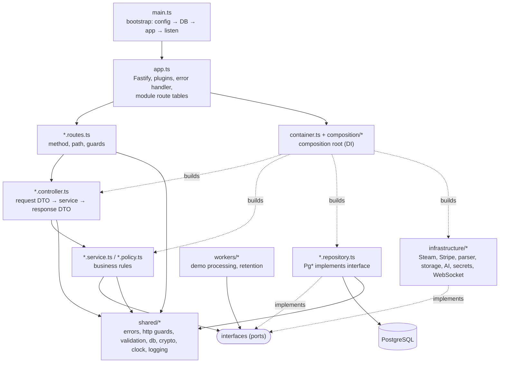
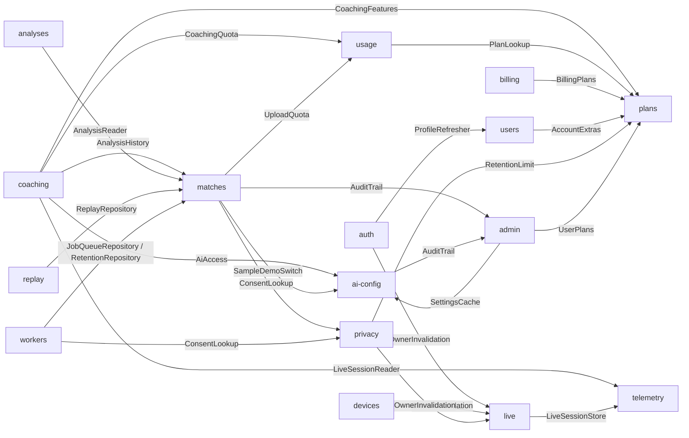

# API architecture

The API (`apps/api`) is a **layered modular monolith** on Fastify + PostgreSQL. Each bounded
context is a module with the same layers (routes → controller → service → repository, plus
DTOs), external systems sit behind ports in `infrastructure/`, and one composition root wires
everything with constructor injection. The decision and the patterns are recorded in
[ADR-004](ADR-004-architecture.md).

## Layers and import rules



| Layer                         | May import                                                             | Must not import                              |
| ----------------------------- | ---------------------------------------------------------------------- | -------------------------------------------- |
| `*.routes.ts`                 | Fastify types, its controller, `shared/http/guards`                    | services, repositories, infrastructure       |
| `*.controller.ts`             | its DTOs, its services (types), `shared/http`, `shared/errors`         | SQL, `drizzle-orm`, other modules' services  |
| `*.service.ts`                | interfaces/ports, DTO types, policies, `shared/errors`, `shared/clock` | Fastify, `drizzle-orm`, `process.env`, `Pg*` |
| `*.repository.ts`             | `drizzle-orm`, `shared/db`, `shared/crypto`, DTO types                 | Fastify, services                            |
| `infrastructure`              | Node/HTTP/third-party libraries, `shared/*`                            | modules' services and controllers            |
| `composition`, `container.ts` | everything (this is where concrete classes meet)                       | —                                            |
| `config/env.ts`               | the **only** reader of `process.env`                                   | —                                            |

Cross-module calls go through an interface declared by the **consumer** (e.g. `AnalysisHistory`
in `coaching/coaching.ports.ts`) and are wired in the composition root.

## Module dependency graph (ports)



## Modules and routes

Guards: **user** = `AuthGuards.requireUser` (Bearer session token), **admin** =
`requireAdmin`, **device** = `requireDevice` (collector token), **public** = none. "coded"
marks routes whose errors always include `code` (see ADR-004, preserved quirks).

| Module    | Method & path                                                                                                                                                                                                                 | Guard                             |
| --------- | ----------------------------------------------------------------------------------------------------------------------------------------------------------------------------------------------------------------------------- | --------------------------------- |
| system    | GET `/health`, `/ready`, `/metrics`, `/openapi.json`                                                                                                                                                                          | public                            |
| auth      | POST `/v1/auth/logout`                                                                                                                                                                                                        | user                              |
| auth      | GET `/v1/auth/steam/start`, GET `/v1/auth/steam/callback`, POST `/v1/auth/exchange`                                                                                                                                           | public (per-IP rate limit 30/min) |
| users     | GET `/v1/me`, POST `/v1/me/refresh-profile`                                                                                                                                                                                   | user                              |
| privacy   | GET `/v1/settings`, PUT `/v1/settings`, DELETE `/v1/account`                                                                                                                                                                  | user                              |
| devices   | GET `/v1/devices`, POST `/v1/devices/pair`, POST `/v1/devices/:id/rotate`, DELETE `/v1/devices/:id`                                                                                                                           | user                              |
| devices   | POST `/v1/devices/claim`                                                                                                                                                                                                      | public (per-IP rate limit)        |
| telemetry | POST `/v1/telemetry/gsi`                                                                                                                                                                                                      | device                            |
| live      | GET `/v1/live/sessions`, GET `/v1/live/sessions/:id`, POST `/v1/live/tickets`                                                                                                                                                 | user                              |
| live      | GET `/v1/live` (WebSocket)                                                                                                                                                                                                    | Origin + single-use ticket        |
| matches   | POST `/v1/demos/uploads` (streaming, `onRequest` admission)                                                                                                                                                                   | user                              |
| matches   | GET `/v1/demos/sample`, POST `/v1/demos/sample`, GET `/v1/matches`, GET `/v1/matches/:id`                                                                                                                                     | user                              |
| matches   | POST `/v1/admin/analyses/reprocess`                                                                                                                                                                                           | admin                             |
| analyses  | GET `/v1/analyses/:id`                                                                                                                                                                                                        | user                              |
| replay    | GET `/v1/analyses/:id/replay/meta`, GET `/v1/analyses/:id/replay`                                                                                                                                                             | user (coded)                      |
| coaching  | GET/PUT `/v1/coach/profile`, GET `/v1/coach/progress`, POST `/v1/coach/reviews/:id/rating`                                                                                                                                    | user                              |
| coaching  | POST `/v1/analyses/:id/coaching`, POST `/v1/ai/live-call`                                                                                                                                                                     | user (AI errors coded)            |
| ai-config | GET `/v1/ai/status`                                                                                                                                                                                                           | user                              |
| ai-config | POST `/v1/ai/test`                                                                                                                                                                                                            | admin                             |
| ai-config | GET/POST `/v1/admin/ai/providers`, PUT/DELETE `/v1/admin/ai/providers/:id`, POST `/v1/admin/ai/providers/:id/test`, GET `/v1/admin/ai/providers/:id/models`, GET/PUT `/v1/admin/ai/assignments`, GET/PUT `/v1/admin/settings` | admin                             |
| admin     | GET `/v1/admin/users`, PUT `/v1/admin/users/:id/role`, GET `/v1/admin/audit`                                                                                                                                                  | admin                             |
| plans     | GET `/v1/plans`                                                                                                                                                                                                               | user (coded)                      |
| plans     | GET `/v1/admin/plans`, PUT `/v1/admin/plans`, PUT `/v1/admin/plans/:id`, PUT `/v1/admin/users/:id/plan`                                                                                                                       | admin (coded)                     |
| billing   | GET `/v1/billing/status`, POST `/v1/billing/checkout`, POST `/v1/billing/portal`                                                                                                                                              | user (coded)                      |
| billing   | POST `/v1/billing/webhook` (raw body, Stripe signature)                                                                                                                                                                       | public                            |
| feedback  | POST `/v1/feedback`, POST `/v1/events`                                                                                                                                                                                        | user                              |

`usage` has no routes: it provides daily plan quotas (`QuotaService`) to matches and coaching.

## Request lifecycle: `POST /v1/analyses/:id/coaching`

1. **Route** (`coaching.routes.ts`) — `requireUser` preHandler resolves the Bearer token through
   `SessionAuthenticator` (`PgAuthRepository`) and sets `request.principal`; 401 otherwise.
2. **Controller** (`CoachingController.review`) — `parseDto(reviewRequestSchema)` → 400
   `"Invalid player"`; builds a `ViewerPolicy` from the caller's role.
3. **Service** (`ReviewService.review`) — loads the owner's analysis (`AnalysisHistory`, 404),
   checks the player exists (404), reserves one plan unit (`CoachingQuota`, 402 `plan_limit`),
   acquires a configured model within the daily cap (`AiAccess`, 503/429), builds
   personalization, calls the model through `AiGateway`, saves the review
   (`CoachingRepository`), logs, and maps the response through `ViewerPolicy`. Any failure
   releases the reservation and is mapped by `aiRequestError` (504/409/502, `code: ai_*`).
4. **Error handler** (`shared/errors/error-handler.ts`) — the single place mapping `AppError`
   to status + body (+ headers such as `retry-after`).

## Directory tree (`apps/api/src`)

```
app.ts
composition/jobs.ts
composition/live.ts
composition/platform.ts
config/api-config.ts
config/env.ts
container.ts
infrastructure/ai/coaching-ai-gateway.ts
infrastructure/ai/model-catalog.ts
infrastructure/billing/null-payment-gateway.ts
infrastructure/billing/payment-gateway-factory.ts
infrastructure/billing/payment-gateway.ts
infrastructure/billing/stripe-payment-gateway.ts
infrastructure/parser/demo-parser.ts
infrastructure/realtime/live-broadcaster.ts
infrastructure/secrets/aes-gcm-secret-cipher.ts
infrastructure/steam/http-steam-client.ts
infrastructure/steam/profile-web-api.ts
infrastructure/steam/profile-xml.ts
infrastructure/steam/sanitize-profile.ts
infrastructure/steam/steam-profile.ts
infrastructure/steam/steam-profile.types.ts
infrastructure/steam/steam-text.ts
infrastructure/storage/object-storage.ts
infrastructure/storage/replay-storage.ts
main.ts
modules/admin/admin.controller.ts
modules/admin/admin.dto.ts
modules/admin/admin.repository.ts
modules/admin/admin.routes.ts
modules/admin/admin.service.ts
modules/ai-config/ai-access.service.ts
modules/ai-config/ai-admin.controller.ts
modules/ai-config/ai-config.dto.ts
modules/ai-config/ai-config.factory.ts
modules/ai-config/ai-config.mapper.ts
modules/ai-config/ai-config.repository.ts
modules/ai-config/ai-config.routes.ts
modules/ai-config/ai-errors.ts
modules/ai-config/ai-provider-admin.service.ts
modules/ai-config/ai-settings.service.ts
modules/ai-config/ai-status.controller.ts
modules/ai-config/app-settings.service.ts
modules/ai-config/provider-update.ts
modules/analyses/analyses.controller.ts
modules/analyses/analyses.routes.ts
modules/analyses/analyses.service.ts
modules/auth/auth.controller.ts
modules/auth/auth.dto.ts
modules/auth/auth.repository.ts
modules/auth/auth.routes.ts
modules/auth/auth.service.ts
modules/auth/identity.ts
modules/auth/openid.ts
modules/auth/static-auth.routes.ts
modules/billing/billing.controller.ts
modules/billing/billing.dto.ts
modules/billing/billing.repository.ts
modules/billing/billing.routes.ts
modules/billing/billing.service.ts
modules/coaching/coach-plans.repository.ts
modules/coaching/coach-plans.service.ts
modules/coaching/coach-profile.service.ts
modules/coaching/coaching.controller.ts
modules/coaching/coaching.dto.ts
modules/coaching/coaching.ports.ts
modules/coaching/coaching.repository.ts
modules/coaching/coaching.routes.ts
modules/coaching/live-call.service.ts
modules/coaching/personalization.service.ts
modules/coaching/progress.dto.ts
modules/coaching/progress.service.ts
modules/coaching/review.service.ts
modules/coaching/viewer.policy.ts
modules/devices/devices.controller.ts
modules/devices/devices.dto.ts
modules/devices/devices.repository.ts
modules/devices/devices.routes.ts
modules/devices/devices.service.ts
modules/feedback/feedback.controller.ts
modules/feedback/feedback.dto.ts
modules/feedback/feedback.repository.ts
modules/feedback/feedback.routes.ts
modules/feedback/feedback.service.ts
modules/live/live.controller.ts
modules/live/live.dto.ts
modules/live/live.routes.ts
modules/live/live.service.ts
modules/live/owner-invalidation.ts
modules/live/ticket-store.ts
modules/matches/job-queue.repository.ts
modules/matches/matches.controller.ts
modules/matches/matches.dto.ts
modules/matches/matches.repository.ts
modules/matches/matches.routes.ts
modules/matches/matches.service.ts
modules/matches/retention.repository.ts
modules/matches/sample-demo.service.ts
modules/matches/upload.service.ts
modules/plans/plan.policy.ts
modules/plans/plans.controller.ts
modules/plans/plans.dto.ts
modules/plans/plans.extras.ts
modules/plans/plans.repository.ts
modules/plans/plans.routes.ts
modules/plans/plans.service.ts
modules/privacy/privacy.controller.ts
modules/privacy/privacy.dto.ts
modules/privacy/privacy.repository.ts
modules/privacy/privacy.routes.ts
modules/privacy/privacy.service.ts
modules/replay/replay.controller.ts
modules/replay/replay.dto.ts
modules/replay/replay.repository.ts
modules/replay/replay.routes.ts
modules/replay/replay.service.ts
modules/system/openapi/account-paths.ts
modules/system/openapi/document.ts
modules/system/openapi/helpers.ts
modules/system/openapi/live-paths.ts
modules/system/openapi/product-paths.ts
modules/system/system.routes.ts
modules/telemetry/in-memory-live-session.store.ts
modules/telemetry/projection.ts
modules/telemetry/telemetry.controller.ts
modules/telemetry/telemetry.repository.ts
modules/telemetry/telemetry.routes.ts
modules/telemetry/telemetry.service.ts
modules/usage/usage.repository.ts
modules/usage/usage.service.ts
modules/users/users.controller.ts
modules/users/users.dto.ts
modules/users/users.repository.ts
modules/users/users.routes.ts
modules/users/users.service.ts
shared/clock/clock.ts
shared/crypto/tokens.ts
shared/db/database.ts
shared/db/migrator.ts
shared/db/rows.ts
shared/db/schema.ts
shared/db/unit-of-work.ts
shared/errors/app-error.ts
shared/errors/error-handler.ts
shared/errors/index.ts
shared/http/cookies.ts
shared/http/guards.ts
shared/http/principal.ts
shared/http/rate-limit.ts
shared/http/validation.ts
shared/logging/logger.ts
shared/logging/metrics.ts
shared/ports/audit-trail.ts
workers/demo-processing.worker.ts
workers/retention.worker.ts
workers/worker-scheduler.ts
```

## Composition modes

`createContainer(config)` (in `container.ts`) builds one of three shapes:

- **Memory** (no `database`): `StaticIdentity` tokens, `InMemoryLiveSessionStore`, telemetry,
  live sessions/tickets/WebSocket and memory-mode logout. Local development only
  (`APP_ENV=local` + `ALLOW_DEV_AUTH=true`) and the live-path tests.
- **Database** (`database` set): adds the platform context (`composition/platform.ts`): auth,
  users, privacy, devices, plans/usage/billing, AI configuration, admin.
- **Database + jobs** (`database` and `jobs` set; production): adds `composition/jobs.ts`:
  uploads, matches, analyses, coaching, AI status, feedback, replay and the background
  workers (`workers/*`, started by `startContainerWorkers` and stopped on `app.close()`).

Shutdown order matters: the database close hook is registered first so Fastify (which runs
`onClose` hooks in reverse) closes it after workers and in-flight Steam refreshes finish.

## Adding a module

1. Create `modules/<name>/` with `<name>.dto.ts` (zod request schemas + response types).
2. `<name>.repository.ts`: `export interface <Name>Repository` and `Pg<Name>Repository`.
3. `<name>.service.ts`: rules only; depend on interfaces; throw `shared/errors` classes.
4. `<name>.controller.ts`: `parseDto` → service → DTO; read the caller with `ownerOf(request)`.
5. `<name>.routes.ts`: `register<Name>Routes(app, controller, guards)` with guard preHandlers.
6. Need another module? Declare a small port interface in your module; implement it there.
7. Wire it in `composition/*.ts` and register the routes in `app.ts`.
8. Add OpenAPI paths in `modules/system/openapi/*`, web DTOs in
   `packages/contracts/src/api/`, unit tests with fakes and an integration test.
9. Keep files under ~300 lines, no `any`, no `process.env` outside `config/env.ts`.

## Testing strategy

- **Unit tests** (`apps/api/test/unit`, plus `plans.unit.test.ts`, `coach.service.test.ts`,
  `replay.service.test.ts`): services, policies and controllers with in-memory fake
  repositories/adapters; no database, no network.
- **Integration tests** (`apps/api/test/*.test.ts`): `buildApp` against a real PostgreSQL
  (`DATABASE_URL`), asserting the HTTP contract end to end. `test/support/test-database.ts`
  (`TestDatabase`) extends `Database` with the module repositories the tests use to arrange
  and assert data; `ApiConfig` overrides inject fakes (payment gateway, clock, Steam fetch,
  job queue, demo parser).
- **E2E** (`tests/e2e`, Playwright) exercises the web app against the real API.

# Web architecture (`apps/web`)

See [ADR-005](ADR-005-web-architecture.md) for the decision and patterns.

```
apps/web
├── app/                      thin routes: page → <FeatureScreen />, layouts keep metadata
│   ├── api/**/route.ts       → src/server/handlers (login, logout, ticket, platform proxy …)
│   └── styles/*.css          global styles (class names are the UI contract)
└── src/
    ├── composition/          AppProviders, AppGate (auth gate + shells), i18n registry
    ├── features/
    │   ├── auth/             session state machine, Steam sign-in/out, SteamIdentity
    │   ├── shell/            AppShell, PublicShell, nav, account menu, LangToggle, footer
    │   ├── landing/          signed-out home        privacy/   public notice
    │   ├── dashboard/        signed-in home         progress/  /progress
    │   ├── matches/          /history, /upload, /demo, MatchRow, SampleImport
    │   ├── analysis/         AnalysisView + tabs (overview, aim, map, rounds, data)
    │   ├── coach/ replay/    /coach flow, 2D clip player
    │   ├── maps/             per-map progress and plans
    │   ├── live/             /live second screen, simulator, AI IGL panel
    │   ├── settings/         Steam, coach personality, consent, devices, deletion
    │   ├── billing/          plans, usage, upgrade sheet, pricing, checkout
    │   └── admin/            providers, assignments, settings, plans, users, audit
    │       each: api/ (XApi + createXApi + context) hooks/ components/ model/ i18n/ index.ts
    ├── shared/               http, i18n, ui, icons, format, hooks, session, di, brand, api-types
    └── server/               route-handler logic (proxy allowlist, session, origin, config)
```

Rules: `app → composition → features → shared`; features import each other only through
`index.ts`; `shared` imports no feature; `fetch(` only in `src/shared/http` and `src/server`.
Enforced by `src/architecture.test.ts` and `eslint.config.mjs`.
