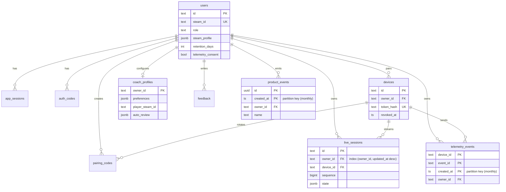
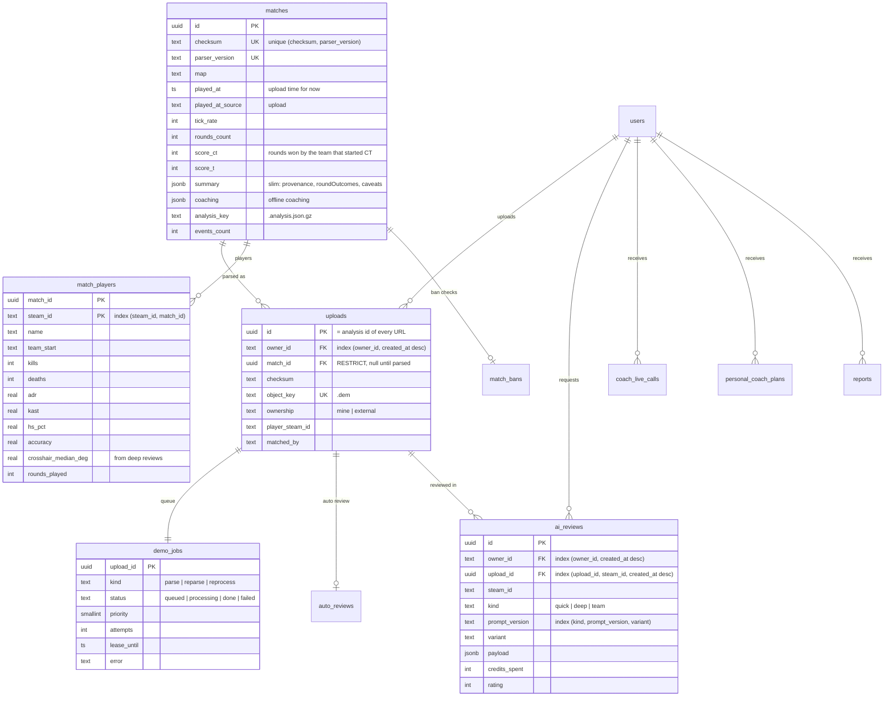
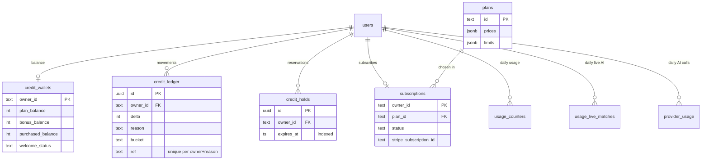

# Database

PostgreSQL schema of the squashed baseline `0001_baseline.sql` (49 tables, of which 6 are monthly
partitions; `schema_migrations` is created by the migrator) plus `0002_public_api.sql` (5 tables
of the public API). Large artifacts live in object
storage, not in Postgres: each upload's `.dem` (`<uploadId>.dem`) and, once per parsed match,
`<matchId>.analysis.json.gz` (the full analysis: players, evidence, integrity…),
`<matchId>.events.json.gz` and `<matchId>.replay.json.gz`.

Every row that belongs to a player hangs off `users.id` with `ON DELETE CASCADE`, so deleting an
account removes all of its data in one statement; matches are shared between accounts and are
reference counted (below). The only deliberate exception is `welcome_grants`, which stores an
HMAC of the Steam ID so that deleting and recreating an account can't claim the free credit again.

Conventions:

- Generated ids are `uuid`. `users.id` stays `text` because the local development identity is
  `dev-owner` (`OWNER_ID`); devices (`dev-device`), live sessions and collector event ids are
  client-chosen text. Ids that come from a request and are not UUIDs match nothing
  (`uuidOrNull`), so they answer 404 instead of failing the query.
- Every foreign-key column is the leading column of an index. `test/schema.test.ts` queries
  `pg_catalog` and fails when one is missing.
- Migrations are plain SQL files applied once each, in name order, inside one advisory-locked
  transaction (`shared/db/migrator.ts`). After migrating, the migrator makes sure the monthly
  partitions of this month and the next two exist.

## Accounts, sessions and devices

## Matches, uploads and the queue

How a demo flows:

1. `POST /v1/demos/uploads` streams the file to `<uploadId>.dem`, inserts the `uploads` row and
   its `demo_jobs` row (`kind=parse`, priority 0 for admins and Pro, 1 otherwise) in one
   transaction, then tries **dedupe**: when a match with the same checksum and the current parser
   version exists, the upload simply points at it (`match_id`) and the job is `done`. Nothing is
   copied.
2. Otherwise the sandboxed worker claims the job (lease, two attempts, one parse per checksum at
   a time), parses the demo, writes `<matchId>.analysis.json.gz`, `.events.json.gz` and
   `.replay.json.gz`, then in one transaction upserts `matches` (unique per checksum + parser
   version), replaces its `match_players`, links the upload and marks the job `done`.
3. The API derives the visible status: `complete` when the upload has a match (an admin re-run,
   `kind=reparse`, hides it until done, as before), else the job's
   `queued`/`processing`/`failed`.
4. Parser upgrades queue `kind=reprocess` jobs: the current analysis stays visible, the upload
   moves to the new match (or to an existing one by dedupe) and the old match goes away when
   nothing references it.

Reference counting: `delete_unreferenced_matches()` deletes matches that no upload references
(unless an upload of the same bytes still has queued or processing work) and schedules their three
files in `file_deletions`. It runs when a job finishes or dedupes, on account deletion and in the
hourly account retention. A match shared with another account is referenced by that account's
upload and survives; each account's `.dem` is its own and follows its own retention.

Readers: every service gets the full analysis document through the `AnalysisReader` port
(`HydratingMatchesRepository`): the match document and events from object storage (LRU-cached by
match id and file mtime) plus the Steam ban check. Numbers per player come from `match_players`
without opening documents: match ownership and the "this is me" identity, progress identity
candidates, Steam ban checks, the personal coach's counters and the monthly report's period
filter. Progress (timeline, learned profile), the lobby comparison, reviews, the reel and the
personal coach generation still read documents, because they need per-round data and evidence.

## Credits, plans and billing

## Configuration and audit (no owner)

`ai_providers` (uuid) ← `ai_assignments` (`RESTRICT`: a provider in use can't be deleted),
`app_settings`, `credit_settings`, `credit_packs`, `integration_settings`, `app_secrets`
(AES-256-GCM), `admin_audit`, `ai_eval_reports`, `billing_events` (Stripe idempotency),
`parser_runtime`, `welcome_grants`, `file_deletions` (object storage outbox), `openid_states`,
`openid_nonces`, `schema_migrations`.

## Public API (`0002_public_api.sql`)

See [PUBLIC_API.md](PUBLIC_API.md). All rows hang off `users.id` with `ON DELETE CASCADE`.

| Table                | What                                                                                                                                                                                                                                                                       |
| -------------------- | -------------------------------------------------------------------------------------------------------------------------------------------------------------------------------------------------------------------------------------------------------------------------- |
| `api_keys`           | Personal keys: `name`, `prefix` (`fm_live_` + 4), `key_hash` (unique, HMAC-SHA256 with a pepper from `APP_ENCRYPTION_KEY`), `scopes text[]`, `last_used_at`, `last_used_ip_hash` (HMAC of the /24 or /48), `expires_at`, `revoked_at`; index `(owner_id, created_at desc)` |
| `api_key_events`     | Audit: `key.created`, `key.revoked`, `key.denied` (scope, expired, revoked), `webhook.created`, `webhook.deleted`; `key_id` `SET NULL`                                                                                                                                     |
| `api_idempotency`    | `Idempotency-Key` of uploads per account: `status` + `response` replayed for 24 hours; `status` null while in flight                                                                                                                                                       |
| `webhooks`           | Endpoint `url`, `events text[]`, `secret_ciphertext` (AES-256-GCM, context `webhook:<id>:secret`), `active`, `consecutive_failures`, `disabled_reason`                                                                                                                     |
| `webhook_deliveries` | Outbox: unique `(webhook_id, event, ref)` (ref = upload or review id), `payload`, `status` pending/delivered/failed, `attempts`, `next_attempt_at` (partial index on pending)                                                                                              |

## Retention

| Data                                                                             | Kept                                                        | Where                                       |
| -------------------------------------------------------------------------------- | ----------------------------------------------------------- | ------------------------------------------- |
| Uploads (+ queue, reviews, auto-reviews), live sessions and live calls, feedback | the account's `retention_days` (1–365, clamped to the plan) | demo worker, hourly (`RetentionRepository`) |
| Matches and their files                                                          | while an upload references them                             | `delete_unreferenced_matches()`             |
| `telemetry_events`                                                               | 30 days (and the account's retention)                       | API daily jobs, hourly (`DataRetentionJob`) |
| `product_events`                                                                 | 180 days (and the account's retention)                      | API daily jobs                              |
| `admin_audit`                                                                    | 365 days                                                    | API daily jobs                              |
| `usage_counters`, `usage_live_matches`, `provider_usage`                         | 90 days                                                     | API daily jobs                              |
| `file_deletions` (processed)                                                     | 7 days                                                      | API daily jobs                              |
| Sessions, pairing/auth codes, OpenID states (expired), OpenID nonces (1 day)     | until expiry                                                | demo worker, hourly                         |
| `webhook_deliveries` / `api_idempotency` / `api_key_events`                      | 30 days / 24 hours / 365 days                               | API webhook worker, hourly                  |

The global values are admin-editable under app settings `retention` (`PUT /v1/admin/settings`
with e.g. `{"retention": {"telemetryEventsDays": 14}}`; absent keys keep the defaults above, and
the key is absent from `GET /v1/admin/settings` until an admin sets it). Old rows are deleted in
batches of 5000 (at most 40 batches per table and run, continued on the next run).

`telemetry_events` and `product_events` are range-partitioned by month on `created_at`
(`<table>_pYYYYMM`). `ensure_month_partitions(table, months_ahead)` creates the current month and
the next two after every migration and on every run of the daily jobs; partitions whose month
ended before the retention cutoff are dropped as a whole. Because a partitioned table's unique
keys must include the partition key, collector event dedupe is a check-then-insert under the
device row lock that ingestion already takes.

## Tests

Tests never touch the development database. The API suites and the E2E stack use
`TEST_DATABASE_URL`, or `DATABASE_URL` with the database name suffixed `_test` (`cs2live` →
`cs2live_test`) on the same server; `apps/api/test/support/global-setup.ts` creates it when
missing and drops schemas left by interrupted runs. Each test file still applies the migrations
inside its own schema (`search_path`), and `scripts/e2e-stack.ts` creates one schema per run in
the test database.

## Review 2026-10-19 (done)

What was right and is kept: one owner key with cascading deletes, the append-only credit ledger
with a unique `(owner_id, reason, ref)` key and a wallet updated in the same transaction, daily
counters as single upserts, encrypted secrets, bulky data in object storage.

What changed (2026-10-20, squashed into `0001_baseline.sql`; the project restarted from an empty
database, the pre-refactor dump is kept outside the repository):

1. **`demo_jobs` split.** `matches` (one row per checksum + parser version, slim summary; the full
   analysis moved to `<matchId>.analysis.json.gz`), `match_players` (indexed per player numbers),
   `uploads` (owner ↔ match, filename, demo object, ownership; replaces `match_ownership`) and
   `demo_jobs` reduced to the queue (the name is kept: it is the demo job queue). Dedupe points the
   upload at the existing match instead of copying the analysis and hard-linking files; matches
   are reference counted and deleted with their files when no upload is left. The `summary` row
   of the real 218 MB Dust2 demo is ~0.5 KB instead of a ~260 KB `analysis` jsonb per upload.
2. **Indexes.** Every foreign key is indexed, among them `ai_reviews(upload_id, …)`,
   `devices(owner_id)`, `live_sessions(owner_id, updated_at desc)`, `pairing_codes(owner_id)` and
   `(device_id)`, `auto_reviews(owner_id)`, `app_sessions(owner_id)`, `auth_codes(owner_id)`,
   `admin_audit(admin_id)`, `subscriptions(plan_id)`, `ai_assignments(provider_id)`,
   `app_secrets/integration_settings(updated_by)`; plus `credit_holds(expires_at)` and the day
   columns of the usage tables for retention. Enforced by `test/schema.test.ts`.
3. **Retention and partitioning** of the append-only tables (above).
4. **`ai_reviews`** replaces `coach_reviews` and `team_reviews` (`kind` quick | deep | team);
   ratings per `(kind, prompt_version, variant)` are one `GROUP BY`. The repositories kept their
   interfaces.
5. **Separate test database** (above). CI sets `TEST_DATABASE_URL`.
6. **`uuid` ids** for every generated id (`users.id` stays `text`).
